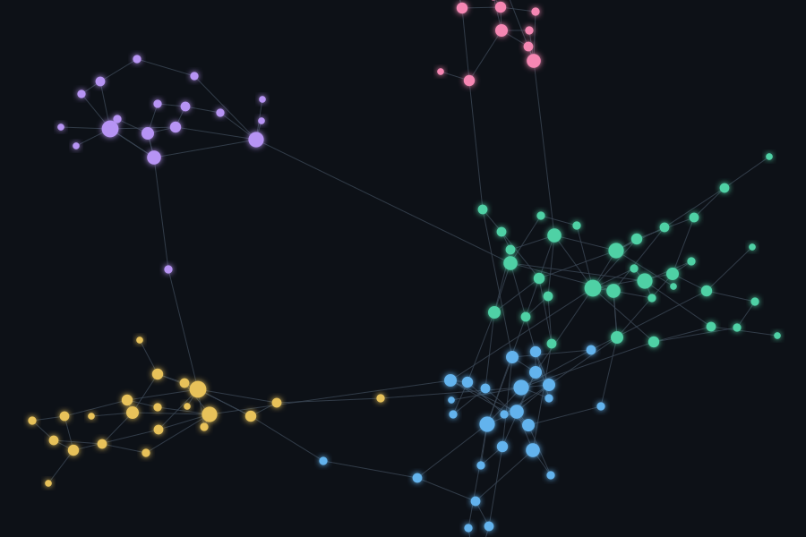

# AI Second Brain

A personal knowledge base in Obsidian that organises itself. Articles and videos are clipped from the browser with one click; every evening an AI agent classifies them, writes summaries, links related notes, updates the index and, on request, turns them into study cards and flashcards.

> **About this repository.** This is a public showcase: architecture, design choices and a few selected source files. The full source code is kept private and can be walked through in an interview. Code comments are in Italian, my working language for this project.

## What it does
- **One-click capture** from the browser (Obsidian Web Clipper) into an inbox folder.
- **Nightly tidy-up.** The server pulls the vault from GitHub, and only if the inbox has new notes wakes the AI agent, so an empty inbox costs nothing. Notes are filed, summarised, linked and indexed, then pushed back.
- **Study mode.** Selected notes become a knowledge base with study cards, questions and flashcards.
- **Sync everywhere.** PC, phone and server stay in sync through a private GitHub repository; the server uses a deploy key limited to that single repository.

## Tech stack
Obsidian · Markdown · Git / GitHub · Claude (Anthropic) · Python (asyncio scheduler) · SSH deploy keys

## Selected code
| File | What it shows |
|---|---|
| [`excerpts/second_brain.py`](excerpts/second_brain.py) | Scheduled pull, inbox check and agent wake-up |

---
William Cuccovillo · [LinkedIn](https://www.linkedin.com/in/william-cuccovillo-7078aab1/)
